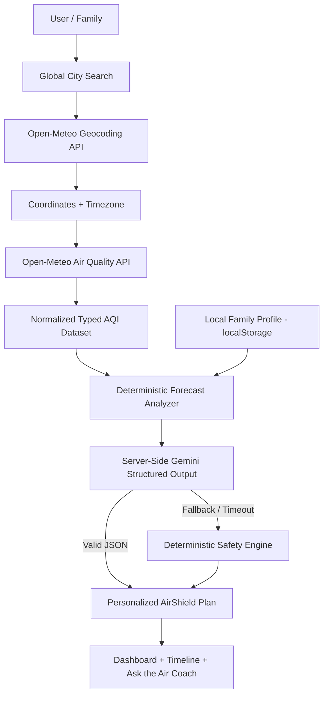

# AirShield — Urban Air Quality Assistant
**Know your air. Protect your people.**

- **Live App (Google AI Studio):** https://ai.studio/apps/eb4a9903-badf-4cc9-9b06-33a816e353b4

## 1. Product Overview

AirShield is a family-focused urban air-quality intelligence assistant. Rather than showing raw AQI numbers in isolation, it combines real-time keyless Open-Meteo air-quality telemetry and 48-hour pollutant forecasts with a household's vulnerabilities, home setup, cooking fuel, and commute mode to produce an actionable **Clean Air Action Plan**.

Key questions AirShield answers immediately:

- **How dangerous is the air right now?** (US AQI hero card + PM2.5, PM10, O₃, NO₂)
- **When should my family go outside, and when should we stay in?** (Safe-window vs. lockdown intelligence)
- **What can we do indoors for ₹0 vs. a small budget?** (Tailored Indoor Air Defense)
- **How should we cook and commute safely?** (Gas/LPG vs. induction, transit/two-wheeler/car/WFH routines)
- **What should I do right now in my exact situation?** (Context-grounded **Ask the Air Coach**)

---

## 2. Challenge Alignment

- **Severe Winter Smog Resilience**: Models winter inversion curves, clearly warns when *no* clean outdoor window exists, and prioritizes ₹0 household containment (damp-towel draft sealing, single clean-room isolation, non-smoking/non-incense routines).
- **Accessible & Inclusive**: Avoids color-only signaling (every US AQI category pairs explicit text labels, range scales, and Lucide icons) and adapts for toddlers/kids, elderly adults, asthma/COPD, pregnancy, and pets.
- **Community-Minded**: Connects household exposure reduction with community-level emission cuts (zero idling, no waste burning, batched errands).

---

## 3. Architecture & Data Flow



---

## 4. Tech Stack

- **Frontend**: React 19, TypeScript, Tailwind CSS v4, Recharts, Lucide React
- **Backend**: Node.js + Express (`server.ts`) hosting Vite middleware in dev and static `dist/` in production
- **AI SDK**: `@google/genai` (server-side only, `gemini-3.1-flash-lite`)
- **Air Quality & Geocoding**: Keyless Open-Meteo Air Quality & Geocoding APIs

---

## 5. Directory Structure

```text
server.ts                     # Express server + Vite middleware + /api/plan & /api/coach routes
src/
  App.tsx                     # Root application & responsive layout
  main.tsx                    # React entry point
  index.css                   # Tailwind v4 & typographic tokens
  types/airshield.ts          # Domain TypeScript interfaces
  data/demoData.ts            # Severe winter smog fallback dataset & preset cities
  services/
    aqiService.ts             # Open-Meteo geocoding, AQI normalization, caching & fallback
    geminiService.ts          # Client wrapper for /api/plan & /api/coach + runtime schema validation
  hooks/
    useAirShield.ts           # Application state, persistence, and async orchestration
  utils/
    aqiUtils.ts               # US AQI severity bands & timezone-aware time helpers
    forecastAnalyzer.ts       # Deterministic min/max/avg, best/worst windows, readiness & exposure budget
    fallbackPlanEngine.ts     # Deterministic recommendation engine when AI is unavailable
    profileLabels.ts          # Human-readable labels for profile fields
  components/
    OnboardingScreen.tsx      # First-time landing screen with Build Plan & Explore Demo
    HeaderBar.tsx             # Single-row top navigation & Ask Air Coach button
    WorkspaceToolbar.tsx      # City search, data freshness indicator, refresh & Demo Mode toggle
    CitySearchInput.tsx       # Debounced Open-Meteo city autocomplete + quick presets
    AqiHeroCard.tsx           # Dominant US AQI hero, pollutants, local clock & Next Best Action
    ReadinessAndExposure.tsx  # AirShield Readiness score & Exposure Guidance cap
    ForecastChart.tsx         # Interactive 24h/48h Recharts trend with threshold lines
    ActionPlanSection.tsx     # Top 3 priorities, safe/least-polluted window & lockdown hours
    HourlyTimeline.tsx        # Horizontally scrollable 24-hour status cards
    IndoorDefenseSection.tsx  # Filterable ₹0, low-budget, purifier & cooking hacks
    CommuteAndHabitsSection.tsx # Commute-mode guidance & community micro-habits
    FamilyProfileWizard.tsx   # 5-step Family Profile configurator
    ProfileSummarySidebar.tsx # Desktop sidebar summary + quick purifier toggle
    AirCoachDrawer.tsx        # Context-aware Ask the Air Coach side drawer / mobile modal
    DashboardSkeletons.tsx    # Non-blocking loading skeletons
    ErrorBoundary.tsx         # React Error Boundary with safe recovery
```

---

## 6. Open-Meteo Integration & Geocoding Flow

1. **Geocoding (`https://geocoding-api.open-meteo.com/v1/search`)**: Debounced (`320ms`) city lookup returning city name, administrative region, country, country code, coordinates, and IANA timezone. Handles empty queries, missing results, timeouts (`7s`), and offline failures gracefully.
2. **Air Quality (`https://air-quality-api.open-meteo.com/v1/air-quality`)**: Fetches hourly `pm2_5`, `pm10`, `us_aqi`, `ozone`, and `nitrogen_dioxide` for 3 forecast days (`timezone=auto`), normalizes into typed observations aligned to the location's local hour, and caches valid responses in memory + `localStorage`.

---

## 7. Gemini Integration & Prompting Strategy

> **Live measurements and forecasts are supplied by the application. Gemini is not allowed to invent current air-quality values.**

- **Server-Side Only**: All `@google/genai` calls execute inside `server.ts` using `process.env.GEMINI_API_KEY`. No keys or secrets ever reach browser bundles.
- **Structured JSON Schema (`POST /api/plan`)**: Uses `responseMimeType: "application/json"` with an explicit `Type.OBJECT` `responseSchema` matching `AirPlan`. Every response is validated at runtime by `validateAirPlan()` in `src/services/geminiService.ts`.
- **Separation of Deterministic Math vs. AI Reasoning**:
  - **Calculated deterministically in TypeScript (`src/utils/forecastAnalyzer.ts`)**: US AQI category, 24-hour min/max/avg, best 3-hour window, peak 3-hour lockdown window, trend direction, `hasCleanWindow`, AirShield Readiness score, and conceptual Exposure Guidance minutes.
  - **Handled by Gemini**: Personalization, household prioritization, natural-language explanations, tailored indoor/cooking/commute guidance, and follow-up Q&A in **Ask the Air Coach** (`POST /api/coach`).
- **Safety Grounding**: System instructions forbid fabricating AQI readings, claiming unhealthy windows are "safe," prescribing medications, suggesting ozone generators/burning, or overstating indoor plants for PM2.5 removal.

---

## 8. Deterministic Fallback Engine & Demo Mode

- **Demo Mode**: One-click activation from Onboarding or the dashboard toolbar loads a realistic **Delhi winter inversion** dataset (`US AQI 340`, `PM2.5 210 µg/m³`, `PM10 330 µg/m³`, `O₃ 42 µg/m³`, `NO₂ 78 µg/m³`) paired with a sample household profile (`Kids`, `Elderly`, `No air purifier`, `Gas/LPG`, `Poor window sealing`, `Public Transit`). Always clearly labeled **DEMO DATA — Not live**.
- **Resilient Fallback**:
  - If Open-Meteo fails after a valid fetch for a city, AirShield preserves the **Cached Live Reading** instead of wiping it.
  - If no cached live data exists, AirShield switches cleanly to **Demo / Offline Data** with a **"Try Live Data Again"** button.
  - If `/api/plan` fails or returns invalid JSON, `generateDeterministicPlan()` produces a complete, profile-personalized action plan without interrupting the UI.

---

## 9. Security & Privacy Considerations

- `GEMINI_API_KEY` is read exclusively on the Node/Express server (`process.env.GEMINI_API_KEY`).
- Family Profile data stays local to the user's browser via `localStorage` (`airshield_family_profile_v1`).
- User chat inputs are length-capped and sanitized; model outputs are rendered as plain text (no `dangerouslySetInnerHTML` or HTML/script execution).

---

## 10. Accessibility

- Explicit US AQI text labels, numeric scales, and Lucide icons accompany every color band.
- Keyboard-accessible controls, `focus-visible` outlines, `aria-expanded` / `aria-pressed` / `role="dialog"` semantics, `tabular-nums` alignment, and `prefers-reduced-motion` CSS rules.

---

## 11. Local Development & Deployment

### Environment Variables

Set the following in `.env` or your hosting environment's Secrets panel (see `.env.example`):

```bash
GEMINI_API_KEY="your_gemini_api_key_here"
```

*(No Open-Meteo API key is required.)*

### Commands

```bash
npm install
npm run dev       # Starts Express + Vite middleware on http://localhost:3000
npm run lint      # Runs TypeScript type-checking (tsc --noEmit)
npm test          # Runs automated unit & integration tests (tsx --test)
npm run build     # Builds production client bundle into dist/
npm start         # Runs production server (node server.ts) on port 3000
```

---

## 12. Assumptions Made

- Air Quality Scale Standard: All AQI thresholds and exposure categories follow the standard US EPA AQI scale (0–50 Good, 51–100 Moderate, 101–150 Unhealthy for Sensitive Groups, 151–200 Unhealthy, 201–300 Very Unhealthy, 301+ Hazardous) for consistent cross-city comparison.
- Forecast Horizon & Diurnal Patterns: Hourly exposure windows (Best Window vs. Lockdown Hour) are evaluated across the upcoming 24-hour local-time window using city-specific IANA timezone offsets so morning/evening temperature inversions are accurately reflected.
- Household Privacy & Local Persistence: User health vulnerabilities, home purifier/cooking setup, and commute modes are stored locally in browser localStorage rather than an external database to preserve user privacy and keep session state resilient offline.
- Resilient Offline / Quota Fallback: If live Open-Meteo telemetry or Gemini API quota is temporarily unavailable, the assistant seamlessly falls back to cached telemetry, deterministic exposure scoring (fallbackPlanEngine), and preloaded demo scenarios without blocking user workflows.

---

## 13. Limitations & Medical Disclaimer

- **Model & Sensor Resolution**: Open-Meteo hourly air-quality forecasts combine atmospheric modeling and regional monitoring; hyper-local street-corner spikes (e.g., construction or roadside idling) can exceed grid-cell averages.
- **Conceptual Indicators**: *AirShield Readiness* and *AirShield Exposure Guidance* are product-generated behavioral planning tools, not clinically validated health scores.
- **Medical Disclaimer**: AirShield provides general environmental guidance, not medical diagnosis or treatment. Always follow your clinician's advice and your existing asthma/COPD or family medical action plan.

---

## 14. Future Improvements

- Multi-room indoor sensor integration (optional BLE/Matter PM2.5 monitor pairing)
- Push/browser alerts ahead of forecasted evening inversion spikes
- Neighborhood school/commute corridor route comparisons
